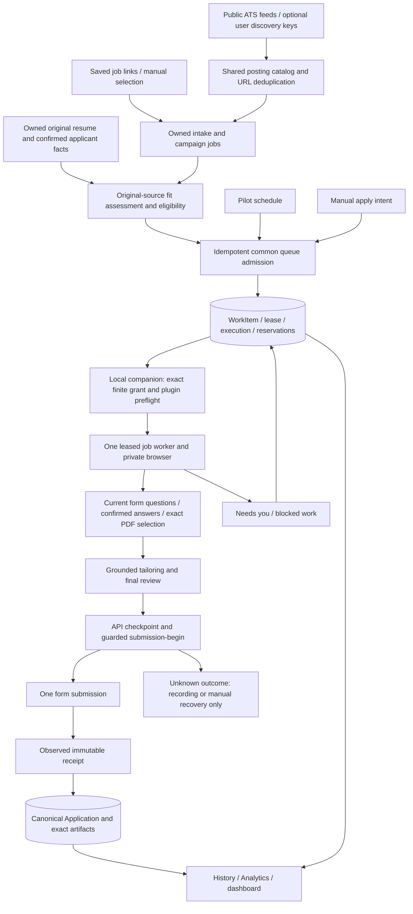

# How OpenApply works

Verified against the implemented worktree on October 8, 2026. OpenApply has a
Next.js web client, an Elysia API backed by PostgreSQL, a local .NET companion,
and a provider plugin. The API owns durable product state; the companion owns
local processes and leased execution. There is no accepted public production
deployment. Completed model-free phase gates do not establish live-agent or
hosted readiness. See the [engineering audit](post-completion-audit-2026-10-08.md)
for findings and the [testing tiers](testing-tiers.md) for evidence boundaries.

## Discovery through recorded submission

This is the implemented ownership model, not a claim that every arrow has a
currently available live executor. General campaign/search/inbox preparation
work can be admitted, but the bounded queue runtime currently accepts application
and intake-preparation allocations only. Production intake preparation remains
disabled by its provider-isolation gate. Such work must remain visibly pending
or blocked; there is no authorized independent Pilot fallback.

## Data, identity and persistence

- API guards scope account-owned records to the authenticated user. Email/password
  and optional Google/GitHub sign-in use JWT cookies; local tools use personal
  access tokens. Narrow preparation capabilities cannot replace ordinary account
  authentication. Mailbox authorization is separate from sign-in.
- PostgreSQL/Prisma owns profiles, originals, variants, campaigns, jobs, queue
  leases, browser ownership, questions, preparation, attempts, receipts and
  Applications. Per-user transactions and uniqueness constraints coordinate
  admission, capacity, domain/company spacing and submission reservations.
- Credentials and discovery keys use per-user encryption keys wrapped by a
  master key. Resume/PDF and submission artifacts live in configured private
  filesystem storage, with revision and byte hashes. Database backups alone
  are not a complete artifact backup.
- SSE delivers invalidations; clients refetch canonical API state. Each topic
  retains at most 64 events, and a slow subscriber closes after 256 pending
  frames. SSE and some operational state remain process-local, so horizontal
  deployment needs additional work.

## Discovery, matching and documents

`job-sources` imports public Greenhouse, Lever, Ashby, SmartRecruiters and Workable
feeds in code. Optional Apify/SerpApi connectors use user-supplied keys. Catalog
publication uses bounded concurrency, canonical URL identities and database
deduplication. Attribution URLs remain separate from application URLs. Unsupported
or unresolved targets stay unresolved rather than being guessed.

`job-intakes` resolves owned links; `mvp/apply-queue.service.ts` admits selected
catalog jobs into saved campaigns and the common queue. Exact URL duplicate
checks are authoritative. The fuzzy historical title/company fallback examines
a limited candidate set and is not a universal semantic duplicate guarantee.

`scoring` supplies full posting, original-source text and preferences for model
judgments, then validates evidence and computes/persists the assessment in code.
Its cache identity binds source bytes, job context and preferences. Original
resume extraction has a bounded process-local cache keyed by actual SHA-256 and
file extension. Every read still reads and hashes the bytes. A cache hit never
authorizes a changed source or bypasses account ownership.

The local inference endpoint supports structured resume extraction. Per-job
tailoring and independent factual review run in plugin workers; the API does not
invoke an LLM. API rewrite/structure guards derive dates and restrict unsupported
facts. PDF compilation and artifact hashing are deterministic. Variant publication
locks and rechecks the owned base version after compilation, including rewrites
with no added evidence. Reusable artifact revisions bind exact PDF/TeX bytes.
Compilation success alone is neither factual validation nor upload consent.

## Queue, browser and recovery

`work-queue` is the durable scheduling authority. Manual apply and campaign actions
enqueue typed work; Pilot's scheduler feeds that same queue. The advanced
interactive terminal still exists for manual skills, but guarded submission-begin
rejects unleased manual execution.

The companion requires a finite grant bound to exact work IDs before claims or
browser allocation. It stages a hash-verified plugin copy per allocation and
adds finite subagent turn limits without editing the installed source. It owns
heartbeats, cancellation, cleanup and completion. Capacity defaults to one and is
bounded at three; API policy and reservations apply across those workers.

Each application worker receives a separate browser process/profile/CDP endpoint
and lease-bound API access. Windows uses WSL; Mac support uses Lima. Uploads stage
exact host artifacts into the guest. The read-only browser viewer checks account,
work, execution and browser identity; screenshots are not submission evidence.
The current broker accepts reviewed Greenhouse/Lever/Ashby URL forms and explicitly
authorized loopback fixtures. An unfamiliar loopback layout test does not prove
arbitrary employer-host support.

Question collection can run without a model. Saved answers are owned, consented,
human-confirmed revisions matched to exact wording/options and relevant country
context; reuse creates a draft, not automatic new consent. Preparation readback
uses a frozen network context and never clicks Next/Submit. Unknown/custom controls
and incomplete coverage stay blockers. This deterministic preparation is distinct
from the disabled model-driven intake executor.

Submission requires a reviewed checkpoint, exact artifact and answers, current
lease, eligibility, authorization and a guarded begin transition. The worker then
submits once, observes a receipt and persists the canonical Application. A model
turn or process exit is not success. Begun/unknown attempts must not be resubmitted;
retained receipts allow recording-only recovery. Expired leases and unanswered
questions park work. Restarting does not erase submission ambiguity.

## Providers and background work

- Ordinary PTY sessions support Claude Code and Codex. They are separate from
  the finite queue grant envelope; their complete token usage is not measured here.
- Bounded queue application work currently uses the Claude subscription route
  and Sonnet request configuration. Its stream ledger records observed usage,
  requested/actual model, execution identity, duration and stop reason. Provider
  token observations can arrive after spending; budget stops may overshoot by an
  in-flight response. No token count converts directly to subscription quota.
- Explicit `/inference` requests use the companion's bounded Claude process;
  Haiku is its existing extraction default, not a new scoring default. A readiness
  request can itself generate a model response. Gmail checks also contain a model
  path. Version/hook checks and normal API health checks are deterministic.
- Pilot cadence is code-owned. Catalog refresh, document-cache pruning, retention
  and Telegram inbox/outbox work are API background services. Telegram delivery is
  deterministic template processing, not a server-side LLM dispatcher.
- The Gmail connector owns local authentication; normalized ingest and reviewed
  reply proposals persist through the API. Legacy mailbox OAuth paths still exist.

## UI and operational limits

The web exposes Queue, inline activity, Needs you, application history, analytics,
campaigns, resume studio, inbox and settings. The advanced terminal remains
available. TanStack Query refetches on owned SSE events and clears
account data when identity changes. Analytics queue depth counts canonical queued
WorkItems rather than obsolete Job status values.

Production readiness still requires reviewed provider context/tool isolation,
current common-queue live acceptance, a supported preparation executor, host
coverage beyond reviewed ATS shapes, deployment/backup testing and operational
monitoring. The historical full-acceptance launcher
remains disabled. A phase document saying its independent gate passed does not
clear these restrictions. See [development commands](development.md).
