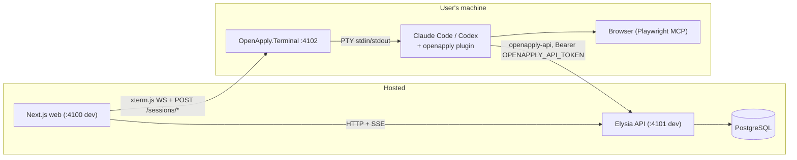
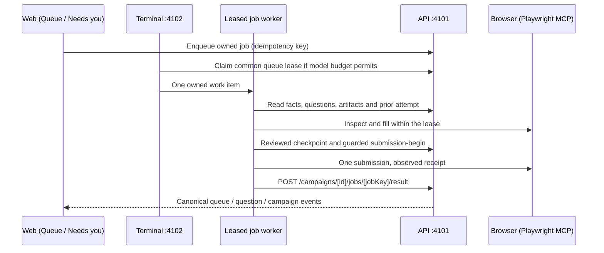

# Development reference

Technical reference for contributors. For the plain-language overview, see
[architecture.md](architecture.md).

Use the [four testing tiers](testing-tiers.md) to select the cheapest sufficient
verification. `bun run test` includes API, contracts, web and every classified
local Node suite. Browser and guest-host suites are explicit commands, not hidden
passes; the Node inventory rejects new unclassified test files. API unit preload
replaces inherited environment settings and rejects database access before sockets.

For Windows setup and Mac beta, follow the [README](../README.md). The commands below assume the database and environment files already exist.

## Local setup

```bash
git clone https://github.com/Jarvuslin/OpenApply.git
cd OpenApply
bun install
bun run db:setup # generates the Prisma client, runs migrations, seeds default data
bun run dev      # web :4100 + api :4101 + terminal :4102
```

There is no local database container. Before running `db:setup`, point
`DATABASE_URL` in [apps/api/.env](../apps/api/.env) at a PostgreSQL you can
reach, either one you run yourself or the remote database through the SSH
tunnel described below.

Open `http://localhost:4100` and toggle the Terminal panel.

### Local application acceptance test

The apply-pipeline fixtures use synthetic employers and an invented applicant. Run
the deterministic fixture, runner, and environment tests without a model:

```bash
bun run test:apply-e2e
```

These tests are also included in `bun run test`. They validate the harness; they
do not prove that an agent submitted an application. The terminal tests remain a
separate command: `dotnet test -c Release`.

The eight browser-dependent test files and three guest-host files are excluded
from the local group. Run them with `test:node:browser` and `test:node:guest-host`
in their configured environments. For example, run the ATS fixture file in the
Windows browser guest:

```powershell
wsl.exe -d OpenApply-MVP -u pilot --exec node --test /mnt/d/Dev/OpenApply/scripts/apply-e2e/fixture-browser.test.mjs
```

Adjust the mounted checkout path for a different workspace. These tests use
their own headless browser and temporary fixture server; they do not submit
completed applications or drive the agent's browser.

Check only infrastructure needed for preserved-evidence UI regression:

```bash
bun run apply:ui --check
```

Run rendered UI verification against preserved, passing synthetic application
evidence. This copies its verified disposable database and storage into a new
disposable environment. It starts API, web and a dedicated browser, with no
companion, provider, ATS submission server, or new application execution:

```bash
bun run apply:ui --source-dir .temp/apply-e2e/phase1-20261008-g --run-id ui-g-unique
```

Use a fresh run ID for each observation. The UI report links the original report
hash, database fingerprints, storage inventory and current source hashes. UI
failures rerun only this model-free command. G's original report is unchanged.
Add `--infra-only` to validate database cloning, source staging, API/web startup
and browser transport while leaving rendered UI explicitly unverified.

Model-driven application acceptance is **disabled**. The historical `apply:e2e`
launcher's dispatch path was removed and only the read-only `--check` preflight
remains. Any other invocation refuses
without reading an approval or provisioning infrastructure. The approval contract
and scenario below describe the retired run and the safeguards a future reviewed
common-queue launcher needs; they are not an available execution path.

Future model acceptance requires new explicit user approval and a one-use approval file.
The approval binds one run, a named subset of fixture cases, Claude/Sonnet,
expiry within 24 hours, one campaign and zero automatic retries. All budget
fields are mandatory: `maxRequests`, `maxTokens`, `maxSubagents`, `maxTurns`,
`maxWorkerTurns`, `maxSeconds`, and `maxBudgetUsd`. The last is a list-price
equivalent, not a Pro charge or percentage. The file is consumed atomically
before provisioning under `.temp/apply-e2e/model-claims/<run-id>.json`; copying
the approval file does not evade that claim. It cannot authorize a retry, including after startup
failure. Creating or copying a file does not substitute for user approval.
No approval is currently granted; do not generate one automatically.

The Queue and question regressions use deterministic services and browsers only:

```bash
bun run queue:verify --run-id queue-unique
bun run questions:verify --run-id questions-unique --database-only
bun run questions:verify --run-id questions-ui-unique --ui-source .temp/questions-regression/questions-unique
bun run test:questions
bun run test:question-collector
```

Question database verification creates and checks a fresh disposable database.
UI verification clones its preserved synthetic state, resets only the clone's
synthetic login, and performs no migrations or agent work. Rerun the UI command
alone for UI failures. Each report checks the source database fingerprint and
records its own source inventory. The real collector browser tests run in the
installed guest, using `plugin/bin/question-collector.test.mjs`; they skip on a
host without the guest's Chromium path. The helper subprocess tests exercise the
installed runtime without a model. Standalone `scripts/questions-regression/host.mjs`
checks the real companion with a zero-call budget and synthetic API/form servers.

`bun run apply:e2e` keeps only its read-only `--check` preflight. The
model-driven acceptance run it used to dispatch was removed with chat, and it
refuses anything else. On this Windows machine the preflight needs the SDK path:

```powershell
$env:OPENAPPLY_E2E_DOTNET = 'D:/Dev/tools/dotnet/dotnet.exe'
bun run apply:e2e --check
```

`bun run apply:ui` is the separate model-free UI runner. It starts an isolated
API and web app against a disposable database and synthetic account, and
observes authenticated pages in the visible browser. Screenshots and
machine-readable evidence are stored outside version control.

The default evidence directory is `.temp/apply-e2e/<run-id>/`. An existing report
cannot be overwritten. Private services use ports `14100` (web), `14101` (API), `14102`
(companion), `14110` (fixtures), and `15433` (a bridge to guest PostgreSQL).
Each private runtime workspace lives outside the checkout in a unique temporary
directory, recorded in `environment.json`. On Windows it stays on the same drive
as the dependencies; when system temp is on another drive, it uses a unique
sibling of the checkout. The model runner inventories its staged plugin; the UI
runner inventories web, API and package sources. Inventories retain byte counts
and hashes, and each stage stops on missing or changed files. Generated web
files and environment configuration are excluded. Runtime files are retained for
diagnosis, alongside the evidence and disposable database; do not remove them
while a run is active.

The private web copy runs Next's development server with `--webpack` so its
dependency symlinks do not cross Turbopack's filesystem boundary. Cleanup stops
only processes created by this run. The synthetic database and evidence remain
available for diagnosis after a failure.
The report saves each job-state change. `owned-processes.jsonl` records private
service process IDs and lifecycle events without command arguments, environment
variables, or process output. If a runner is terminated abruptly, a report still
marked running is incomplete evidence and must not be treated as success.
The runner migrates only the uniquely created disposable database after checking
its identity. Running any migration on a non-throwaway database requires the
user's approval.

Read the dated phase report in `docs/` for the latest executed result and any
prerequisite failures. A stage that is blocked or not run remains unverified.
Real-employer applications require a separately approved case list after all
fixture acceptance checks pass.

### Remote database (SSH tunnel)

To point the API at a remote PostgreSQL, open an SSH tunnel and target it
locally. Set the `SSH_TUNNEL_*` / `REMOTE_DB_*` / `LOCAL_DB_PORT` vars in
[apps/api/.env](../apps/api/.env) (see
[apps/api/.env.example](../apps/api/.env.example)), then:

```bash
bun run db:tunnel   # binds localhost:5433 -> remote db through the SSH host; Ctrl+C to close
```

With the tunnel up, set `DATABASE_URL=postgresql://<user>:<pass>@localhost:5433/<db>`
in [apps/api/.env](../apps/api/.env). `db:setup`, `db:studio`, and the API all
then run against the remote DB. Set `REMOTE_DB_HOST` to `127.0.0.1` when the
database runs on the SSH server itself, or to its private host when tunneling
via a bastion.

## Repository layout

- [apps/web/](../apps/web/): hosted Next.js dashboard (dev `:4100`).
- [apps/api/](../apps/api/): hosted Bun + Elysia + Prisma API; owns all state
  (dev `:4101`, Swagger at `/swagger`).
- [apps/terminal/](../apps/terminal/): .NET host that runs on each user's
  machine and bridges one Claude Code / Codex PTY to the dashboard
  (dev `:4102`).
- [plugin/](../plugin/): one provider-neutral plugin for both Claude Code and
  Codex, holding skills, worker subagents, and the Playwright MCP config. No
  build step.
- [packages/](../packages/): shared Zod contracts and the typed Eden Treaty
  API client.

## Tech stack

| Layer              | Choice                                         |
| ------------------ | ---------------------------------------------- |
| Runtime            | Bun 1.3                                        |
| Web                | Next.js 16 (App Router, RSC, typed routes)     |
| UI                 | MUI 9 + MUI X DataGrid                         |
| Forms              | TanStack Form 1 + Zod v4                       |
| Server state       | TanStack Query 5                               |
| API                | Elysia + Eden Treaty (end-to-end types)        |
| Database           | PostgreSQL via Prisma 7 + `@prisma/adapter-pg` |
| Realtime           | In-process SSE channels                        |
| Terminal host      | .NET 10 ASP.NET Core, ConPTY via Quick.PtyNet  |
| Browser automation | Playwright via the Playwright MCP server       |

## Architecture internals

The intended topology supports hosted web + API and a terminal host/provider
plugin on each user's machine; hosted deployment acceptance is still outstanding.
The local agent authenticates as the signed-in user via a
personal access token the terminal injects into the PTY.

### Topology



### Components

- **[apps/web/](../apps/web/)**: Next.js UI covering the pipeline, campaigns
  with live per-job progress, inbox, resume studio,
  analytics, settings, and the agent dock (an xterm.js panel that installs,
  launches, and monitors the local agent). Browser and server both call the
  API directly via `API_BASE_URL`, with no proxy in between.
- **[apps/api/](../apps/api/)**: Elysia + Prisma; owns all state. Typed
  `/api/*` surface, Swagger at `/swagger`, Prisma schema split per domain
  under `apps/api/prisma/schema/`.
- **[apps/terminal/](../apps/terminal/)**: ASP.NET Core minimal API owning
  one provider PTY (ConPTY via Quick.PtyNet), bridged to the web's xterm.js
  over WebSocket. Endpoints: `POST /sessions/start`,
  `DELETE /sessions/current`, `GET /healthz`, `GET /ws`. `/sessions/start`
  takes the user's terminal token and spawns the provider with
  `OPENAPPLY_API_TOKEN`, `OPENAPPLY_API`, `OPENAPPLY_WEB` (plus
  `OPENAPPLY_SKILLS_ROOT` / `OPENAPPLY_WORKSPACE_ROOT` for wrappers) and
  `plugin/bin` first on `PATH`, so skills call the API through `openapply-api`
  with zero manual setup.

The advanced interactive terminal owns one PTY. Separately, the common queue owns
up to three bounded workers, each with its own provider process and browser.
The PTY survives tab close: reopening the panel
reattaches a WebSocket to the live session and replays the buffered tail
(`TerminalRelay`, 512 KB, cleared when a new session starts). Switching providers
restarts the PTY. On a new release the agent dock shows an update banner;
the guided flow updates host + plugin and finishes with `/reload-plugins` on
Claude.

### Plugin loading

[plugin/](../plugin/) is one provider-neutral tree, no generation step:

- `skills/<name>/SKILL.md`: one workflow per directory; shared docs in
  `skills/_shared/` (no `SKILL.md`, so neither provider lists them as skills).
  Skills reference siblings by name and shared docs by relative path
  (`../_shared/<doc>.md`), so the same text serves both providers.
- `agents/*.md`: worker subagents (`job-worker`) that
  campaign skills delegate per-iteration work to, isolating heavy browser
  output. Claude auto-discovers them; [.codex/agents/](../.codex/agents/)
  point at the same `.md` bodies. Runtimes without subagents run inline.
- `.mcp.json`: Playwright MCP server.
- `.claude-plugin/plugin.json` + `.codex-plugin/plugin.json`: provider
  manifests (Codex ignores Claude-only frontmatter like `allowed-tools`).
- `settings/claude.json` + `settings/codex.json`: shipped agent config. Not
  `settings.json` at the plugin root: that name is reserved and honors only the
  `agent` and `subagentStatusLine` keys.

The advanced interactive terminal launches
`claude --permission-mode auto --settings plugin/settings/claude.json --plugin-dir plugin`
or `codex --no-alt-screen --approve-for-me -c <override>`. Both run
under automatic approval review, so a blocked action prompts in the dashboard
terminal. `settings/claude.json` pins Sonnet and describes the OpenApply API
under `autoMode.environment`. Codex has no `--settings` flag, and a project
`.codex/config.toml` loads only for trusted projects, so
[CodexProvider](../apps/terminal/Providers/CodexProvider.cs) expands
`settings/codex.json` into `-c` arguments. A missing file logs a warning and
still launches.

Bounded queue execution uses a different preflight: before consuming its grant or
claiming work, the companion stages and hash-verifies a per-allocation plugin,
injects finite subagent turn caps and validates model restrictions. It verifies
the snapshot again before launch. Missing settings/agents fail closed. The local
metadata ledger records observed token/cache counters, requested/actual model,
execution identity, elapsed time and stop reason without retaining prompt or
tool-result bodies. This staging does not establish provider context/tool isolation.

Codex has no `--plugin-dir` either. Before launch, the host mirrors the bundled
skill tree into `<root>/.agents/skills`, Codex's repository-local discovery
location (excluding the marketplace-owned `setup` bootstrap) and translates
the bundled `.mcp.json` into `-c mcp_servers.*` overrides. The publish output
also bundles `.codex/agents/*.toml` for worker parity. Both provider
marketplaces contain only `setup`; the full runtime tree comes from the host.
OpenApply releases publish terminal archives with the runtime plugin bundled.
The marketplace sync script is available for operator-owned marketplaces and
is not run against upstream repositories. Root `.claude/settings.json` is repo
trust policy. The plugin owns behavior.

### Apply lifecycle



Pilot schedules ordinary work into this queue; it has no independent execution
loop. Question collection is a separate code-only operation that needs no model
budget or application lease. Human answers remain usable while the computer is
offline. Unresolved facts, coverage and submission ambiguity stay explicit blockers.

Saved answers are account-owned, consented copies of current human-confirmed
question answers. The bank matches exact wording and typed option labels in code.
Sensitive answers require explicit country context, and every match fills an
unconfirmed draft. `/settings/answers` exposes source evidence, immutable revisions,
correction and revocation. Historical profile defaults never seed saved answers.

`bun run answers:verify --run-id <fresh-id> --database-only` verifies answer-bank
transactions on a newly created disposable database. Run the rendered UI separately
with `bun run answers:verify --run-id <fresh-ui-id> --ui-source <passing-evidence-dir>`.
The latter clones preserved synthetic evidence, validates its fingerprint and makes
no migrations or model calls. UI failures never authorize application reruns.

Supported resume upload questions require explicit selection of an owned canonical
PDF. The selection binds its exact revision, bytes and original source to the
current question. Changing or removing the source restores the Needs-you blocker;
retention preserves selected variants. A filename or successful PDF compilation
does not establish consent or factual accuracy.

The job's preparation check uses the local companion with no model budget. It
opens a fresh browser context, freezes network traffic before filling confirmed
facts and PDF bytes, reads back native controls, and closes the context. It never
clicks Next or Submit and does not leave a prepared live application behind.
Unknown prose, custom controls and incomplete dynamic coverage remain for review.

`bun run preparation:verify --run-id <fresh-id> --database-only` verifies document
selection and preparation invariants in a new disposable database. A separate
`bun run preparation:verify --run-id <fresh-ui-id> --ui-source <passing-evidence-dir>`
clones the preserved synthetic database and exact document storage for rendered
UI checks through a dedicated zero-budget companion. Source fingerprints must
match before and after; the runner makes no migrations in the clone. Use
`bun run test:preparation` for harness guards. Run the browser fixture test inside
the configured guest, where Chromium and Playwright are installed. None of these
checks authorizes a model campaign or proves final application submission.

Scoring evaluations freeze the original scoring context and keep append-only
comparison results separate from production scores. `/analytics/scoring` shows
coverage, excluded pairs, quote validation, disagreement and usage provenance.
Historical and simulated results do not count as measured model comparisons.

`bun run scoring:verify --run-id <fresh-id> --database-only` verifies evaluation
transactions in a new disposable database. Use a separate
`bun run scoring:verify --run-id <fresh-ui-id> --ui-source <passing-evidence-dir>`
for rendered reports against a verified clone; it preserves the source database
and report. `bun run test:scoring` exercises harness guards without
calling a provider. The sanitized Phase 1 G corpus preserves historical scores;
it does not generate new scoring requests or establish a model's accuracy.
Sonnet remains the production scoring default.

Queue concurrency defaults to one worker and can be raised to three. Account caps,
company windows, domain spacing and held submission reservations are enforced in
the API across restarts. The Queue estimate covers the whole queue; it does not
start work or infer model usage. Missing provider usage remains unavailable.

Each worker receives a distinct browser process, private profile and CDP endpoint.
Scripted preparation in that browser stays frozen until an exact leased handoff;
it never clicks Next or Submit. Parking closes the process and retains bounded
private evidence. No shared-browser fallback or automatic ambiguous-submit retry
is allowed. A finite, exact-work-item model grant is required before any claim,
browser allocation or provider launch; missing grants leave execution disabled.

`bun run concurrency:verify --run-id <fresh-id> --database-only` verifies claims,
reservations, caps, selected document integrity and policy races in a new disposable
database. Use `bun run concurrency:verify --run-id <fresh-ui-id> --ui-source
<passing-evidence-dir>` for independent rendered policy/estimate checks. It clones
preserved synthetic evidence and starts no companion or model. Run
`bun run test:concurrency` for harness guards. Browser isolation and fake-process
budget checks are independent from any explicitly approved model campaign.

### Live updates

Queue activity opens beside the saved work list. Its browser view is read-only,
requires an explicit View action, and verifies the account, work item, execution
and browser session for every frame. Viewer errors do not stop a worker or renew
its lease. The view follows the original owned job tab; it does not automatically
switch to popups or other tabs. A frame is not application evidence; saved submission records remain
authoritative.

`queue-experience:verify --run-id <fresh-seed-id> --seed-source
<passing-telegram-evidence-dir>` creates a verified disposable
clone and adds clearly synthetic Queue UI evidence. A separate
`queue-experience:verify --run-id <fresh-ui-id> --ui-source
<passing-queue-experience-evidence-dir>` clones that evidence for laptop rendering
checks. UI retries do not rerun preparation or application behavior. Browser-frame
responses in this UI test are explicitly simulated; independent companion and
Chromium checks verify the actual read-only transport. Neither path invokes a
provider. Use `test:queue-experience` for runner guards.

Intake preparation requires immutable target/source scope and a distinct finite
grant. Its production dispatch remains disabled while enforceable subscription
provider tool isolation is unverified. Approval alone cannot clear that technical
gate, and the general account token must never replace its scoped capability.

Skills mutate through `/api/campaigns/*`; the web opens
`EventSource /api/campaigns/[id]/events` and invalidates the TanStack Query
cache on each event, refetching canonical state from PostgreSQL. Other
channels (`workspace`, `inbox`, `resume`, `pilot`) follow the same
pattern; they are defined in `packages/contracts/src/sse/channels/`.
Slow subscribers close after 256 pending frames; a reconnect uses the bounded
topic history and canonical refetch. Events are invalidations, not durable state.

### Skills layer

`plugin/skills/_shared/setup.md` is the single source of truth for config
loading: `/api/health` → `GET /api/user` (the bare payload, no `data.` wrapper)
→ `GET /api/credentials/resolve?domain=…`; resumes via
`primaryResumeSourceAbsolutePath` or `GET /api/resumes/[id]/pdf`. `auth.md`,
`form-filling.md`, and `browser-tips.md` cover cross-cutting browser behavior;
`campaign-flow.md` holds the campaign mechanics every apply skill shares
(applied-check, result writes, worker input, rules); the writing skills chain
the `humanizer` skill by name, in **embedded mode** so only the final text comes
back.

The resume skills form a chain, one rule each:

- `extract-resume` parses the PDF into `ResumeData` verbatim, improving
  nothing and inventing no fields. Chains `review-resume` on a *first*
  extraction only; `--force` skips it, since the user asked for what the PDF
  says.
- `review-resume` writes one `Suggested rewrite` variant whose `diffNotes` list
  every change. It never touches a base; the dashboard's Apply action does that
  via `POST /api/resumes/variants/[id]/apply`, which copies the content onto the
  base and deletes the variant in one transaction, so the suggestion is never
  applied while still being offered. The stored source PDF is the way back.
- `tailor-resume` owns per-job variants: base selection, the reuse-vs-create
  score, rewording any entry, and `structure` (reorder, drop, merge, promote
  projects).

The guards in `apps/api/src/modules/resume/structure.ts` are the design: the
model picks *which* entries combine, the server derives every date and
whitelists umbrella employer names, so no request can add an employer or widen a
range. The prose guards split by concern: `rewrite/facts.ts` knows what the resume
states (numbers, tech names), `rewrite/phrasing.ts` knows what reads as machine-written,
`rewrite/rewrite.ts` checks reworded bullets against their originals, and `rewrite/prose.ts`
checks the summary and headline against the base. Anything a check can prove is a
422, not a flag, because a flag the agent echoes and moves past is a fabrication
the user never sees. The one soft flag left is a retitle sharing no word with the
original, where the overlap test guesses: "SWE II" to "Software Engineer" is an
honest expansion that shares no word, so rejecting it outright would cost more
than flagging it.
