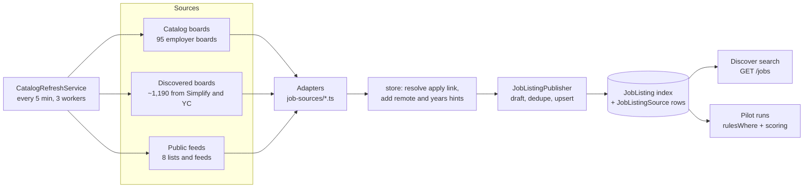

# Job board architecture

Updated October 16, 2026. This replaces the source lists in
[discover-sources-and-scale.md](discover-sources-and-scale.md), which predate Workday,
SuccessFactors, Phenom, discovered boards and the internship feeds.

OpenApply keeps one shared job index, `JobListing`. Background jobs fill it from public employer
job boards and public lists. Discover search and pilots both read from that index; neither one
calls a job site while a user waits. On October 16, 2026 the index held **103,941 public jobs
from 2,838 companies**, and 1,708 of them (1.6%) had no posting date.

## The pipeline at a glance

1. **Schedule.** `catalog-refresh.job.ts` runs on startup and every five minutes. It asks
   `CatalogRefreshService.refreshDue` for feeds that are due and runs up to three at once. Each
   feed has a `job_feed_refreshes` row with a one-hour lease, so two API processes never refresh
   the same feed. Set `JOB_FEED_REFRESH_ENABLED=false` to turn the schedule off.
2. **Fetch.** An adapter reads one board or feed and returns `SourceJob`s: title, company,
   location, URL, description, posting date and sometimes level or countries.
3. **Store.** `JobSourcesService.store` caps the batch (5,000 jobs per board, 6,000 per feed).
   For each job it finds a direct employer apply link and adds a digest with `remote` and
   `yearsExperience` (read from the description), then publishes it.
4. **Publish.** `JobListingPublisher` builds a draft (`listing-draft.ts`), works out whether the
   job is new or already known, and writes the listing and its source row.

All network access goes through `job-sources/http.ts`. It allows only listed hosts and paths,
requires HTTPS, refuses redirects, waits 500 ms between requests to the same host (longer when
robots.txt sets a crawl-delay), times out after 30 seconds, and stops reading at 20 MB. A 429
pauses the whole host; Common Crawl's 503s are retried slowly, up to six times.

Every request is checked against the host's robots.txt, including the career-site path of a
Workday board. The exceptions:

- **Calls made with the user's own API key** (an `Authorization` header or `api_key` parameter),
  such as Apify and SerpApi: robots.txt governs crawling, not paid APIs we're a customer of.
- **`api.smartrecruiters.com` and `rbc.wd3.myworkdayjobs.com`**, exempt for personal use.
- **`data.commoncrawl.org`**, Common Crawl's documented public download endpoint: robots.txt there
  blocks crawling, not downloads.

## Working job boards

### Employer boards (catalog)

These live in `JOB_FEED_CATALOG` in `job-sources/catalog.ts`: 112 boards. Small
JSON boards refresh every 10 minutes. Workday, SuccessFactors, Phenom and Oracle boards refresh every
three hours, because one board can take up to 100 requests.

| System | Adapter | Employers | Posting date |
| --- | --- | --- | --- |
| Greenhouse | `greenhouse.ts` | Anthropic, Figma, Datadog, Cloudflare, MongoDB, Airbnb, Affirm, Robinhood, Reddit, Coinbase, Stripe, Databricks, Discord, Duolingo, Dropbox, GitLab, Asana, Scale AI, Brex, Instacart, Roblox, DoorDash, Gusto, Chime, Lyft, Pinterest, Twilio, Okta, Elastic, Samsara, Fastly, Cockroach Labs, Squarespace, Toast, Klaviyo, Webflow, Vercel | `first_published` (the last-edit time is ignored) |
| Ashby | `ashby.ts` | OpenAI, Notion, Ramp, Linear, Cohere, Ashby, Zip, Cerebras, Wealthsimple, 1Password, Replit, Supabase, Perplexity, ElevenLabs, Modal, Cursor | `publishedAt` |
| Lever | `lever.ts` | Palantir | `createdAt` |
| SmartRecruiters | `smartrecruiters.ts` | ServiceNow, Canva | `releasedDate` |
| Workable | `workable.ts` | Hugging Face | `published_on` |
| Workday | `workday.ts` | **Banks and insurers:** RBC (+ early talent), TD, BMO (+ campus), CIBC (+ campus), Manulife, Sun Life (+ campus), Desjardins, Intact, Ontario Teachers' Pension Plan. **Canadian enterprise:** Thomson Reuters, BlackBerry, Ciena, Mitel, CAE, Canadian Tire, Magna, Enbridge, TC Energy, Suncor. **Big tech with Canadian offices:** NVIDIA, Salesforce, Adobe, Autodesk, Intel, PayPal, Mastercard, Visa, Cisco, Workday | Relative text such as "Posted 3 Days Ago"; "30+ Days Ago" is dated 31 days back so it never looks new |
| SuccessFactors | `successfactors.ts` | Scotiabank (with Tangerine), Rogers, TELUS | "Oct 15, 2026" from the search page |
| Phenom | `phenom.ts` | Bell, OpenText | ISO `postedDate` |
| Oracle Recruiting | `oracle.ts` | **Tech and enterprise:** Oracle, Uber, Nokia, DTCC, Ford, onsemi, Emerson, Chubb. **Hotels:** Marriott, Hilton, IHG. **Hospitals:** Lifepoint Health, UC Health, TriHealth, Community Health Systems. **Retail and services:** Federated Co-operatives, WM | `PostedDate` from the list; the exact `ExternalPostedStartDate` time once the detail is read |

How the career-site adapters read a board:

- **Workday.** Slug `tenant.wdN.site`, for example `rbc.wd3.rbcglobal1`. The adapter POSTs to
  `/wday/cxs/{tenant}/{site}/jobs` 20 jobs at a time. A job posted in several cities only says
  "N Locations", so its location is left blank rather than guessed.
- **SuccessFactors.** Slug is the career site's host, for example `jobs.rogers.com`. The adapter
  reads the public `/search/` page newest first, 25 rows at a time. It doesn't use `/services/`,
  which robots.txt disallows.
- **Phenom.** Slug `host/country/locale/tenant`, for example `jobs.bell.ca/ca/en_CA/BECACA`.
  The adapter POSTs the site's own `/widgets` search with `ddoKey: refineSearch`, asking for 500
  jobs at a time. Results come in no stable order, so small pages would repeat and skip jobs.
  Every city a job lists is kept.
- **Oracle Recruiting.** Slug `host/site`, for example `eeho.fa.us2.oraclecloud.com/CX_45001`.
  The adapter GETs the public `recruitingCEJobRequisitions` finder newest first, 200 jobs at a
  time, the most it returns. A full page sometimes comes back a row short, so only an empty page
  or the reported total ends a board. Jobs with a thin list description are read from
  `recruitingCEJobRequisitionDetails`, within the usual detail budget. Any `*.oraclecloud.com`
  host is allowed, but only on those two endpoints.

Each Workday, SuccessFactors and Phenom host is named in `http.ts`. Adding an employer on one of
these systems means adding it to the catalog and, for SuccessFactors and Phenom, to that file's
allowlist.

### Discovered boards

More employer boards are found automatically and stored in `discovered_job_boards`. They refresh
every three hours (Workday boards daily) and are dropped after 30 days without being seen again;
a board whose API answers 404 is marked gone and rechecked after 30 days.

- **From the Simplify and Canadian lists** (`discovery/simplify-boards`, daily). `simplifyBoards`
  and `canadianBoards` read every apply link in the Simplify new-grad and Summer2027 internship
  lists and the Canadian Tech Internships list. Each link that points at a board an adapter can
  read (`boardOf`, Workday included) is added. A new Workday board is kept only after one request
  shows it lists jobs; robots.txt disallows about one in eight of them.
- **From Common Crawl** (`discovery/common-crawl`, monthly; `discovery/common-crawl-check`, every
  30 minutes). `commonCrawlBoards` reads the newest crawl's columnar index with range requests:
  every file's footer, then only the `url` column of the row groups whose SURT range covers
  Greenhouse, Lever, Ashby or Workday hosts, about 335 MB in all. New boards wait as pending
  probes, and the check validates 300 at a time with one request each (`checkBoard`).
- **From Y Combinator** (`discovery/yc-boards`, 100 companies every 30 minutes, each one
  rechecked after 14 days). `discoverYcBoards` reads the yc-oss list of hiring YC companies and
  tries likely slugs on Ashby, Greenhouse, Lever and Workable. A board is kept only if its first
  postings mention the company's name or domain (`boardBelongsTo`). So far 1,493 companies have
  been checked and 454 had a board.

### Public feeds

These are listed in `PUBLIC_FEED_CATALOG` and refresh every 30 minutes.

| Feed | Adapter | What it reads | Posting date |
| --- | --- | --- | --- |
| Simplify · New Grad | `public-feeds-simplify.ts` | Every active, visible new-grad role in SimplifyJobs' `listings.json` that has a direct employer link | `date_posted`: when Simplify listed it |
| Simplify · Internships | `public-feeds-simplify.ts` | Same, from `Summer2027-Internships` (about 4,800 roles) | `date_posted` |
| Canadian Tech Internships | `public-feeds-canada.ts` | Open rows of the `negarprh/Canadian-Tech-Internships-2027` README table (about 190); closed rows are skipped | "Date Posted" column |
| Remote OK | `public-feeds-remoteok.ts` | The public JSON feed | Its `date` |
| We Work Remotely | `public-feeds-wwr.ts` | The official RSS feed | `pubDate` |
| Hacker News · Who is hiring? | `public-feeds-hackernews.ts` | Up to 500 comments from the newest monthly thread | Comment time |
| Hacker News · YC jobs | `public-feeds-hackernews.ts` | Up to 200 job stories | Story time |
| Google Careers | `public-feeds-google.ts` | Search result and job detail pages | None |

The two Simplify lists and the Canadian list are community lists that link to employer boards.
When one of their jobs is already in the index from the employer's own board, that board stays
the job's source label. The list only adds the date.

### Private and preview-only sources

- **LinkedIn (logged out).** The `services/jobspy-worker` worker claims at most one run a day
  (`POST /job-sources/linkedin/runs`) and posts results back. Those listings are private to that user
  (`PersonalJobListing`) and never enter the shared index. The local launcher doesn't start this
  worker.
- **Apify and SerpApi.** These use the user's own API key, from `POST /job-sources/discover`.
  Results go into the shared index.
- **HiringCafe.** Previews only; nothing is stored.

### Live counts by source

Counted on October 16, 2026. These are listings with a public source row from each site. A job
seen on two sites counts under both.

| Source | Listings | Source | Listings |
| --- | ---: | --- | ---: |
| SmartRecruiters | 29,188 | Workable | 1,612 |
| Greenhouse | 25,623 | Phenom | 430 |
| Ashby | 16,048 | Google Careers | 295 |
| Workday | 15,934 | We Work Remotely | 250 |
| Lever | 6,774 | Hacker News · hiring | 248 |
| Simplify · Internships | 3,391 | Canadian Tech Internships | 139 |
| Simplify · New Grad | 2,255 | Remote OK | 123 |
| SuccessFactors | 1,755 | Hacker News · YC jobs | 33 |

Six of the 1,295 feeds were failing on that day:

- Two Ashby boards that no longer exist (404).
- Three boards larger than the 20 MB response cap: SpaceX, Anduril and CGS Federal.
- One Workable board that was rate-limited (429).

### Not covered

- **CN and Sobeys.** CN's career site renders jobs with script, and its only data endpoint sits
  under a path robots.txt disallows. Sobeys runs a custom WordPress site behind a per-session
  token and asks crawlers to wait 10 seconds between requests.
- **TELUS Digital and Dell.** Both refuse Workday API requests.
- **Indeed, Glassdoor, Handshake and Wellfound.** These need a login or forbid automated access.
  Their links are also blocked as apply links.
- **Job Bank Canada.** Its terms ban automated access.

[entry-level-sources-research-2026-10-15.md](entry-level-sources-research-2026-10-15.md) has the
research behind these choices.

## From a raw posting to one listing

**Apply link.** `EmployerResolver.resolve` (`resolver.ts`) uses the job's own URL when it's a
direct employer link. Otherwise it tries to find the same job on the employer's board:

- It checks a cached board for the company, the catalog, and boards seen on other listings from
  that company.
- Then it guesses slugs on Ashby, Greenhouse, Lever, SmartRecruiters and Workable. Workday,
  SuccessFactors and Phenom slugs can't be guessed from a company name.
- A match needs a similarity of at least 0.88 on title and location, with no close runner-up.

`allowedApplyUrl` (`job-board/blocked-sites.ts`) rejects LinkedIn, Indeed, Glassdoor,
ZipRecruiter, Upwork, Handshake and Wellfound. A job with no usable apply link is still listed,
but a pilot never queues it.

**Draft.** `buildListingDraft` in `listing-draft.ts` sets:

- `level` from the title: intern, entry, mid, senior, lead or executive. If the title doesn't
  say, it takes the feed's own level; Simplify defaults to entry or intern. Otherwise the level
  is `unknown`.
- `countries` from the feed, or worked out from the location text (`listing-countries.ts`).
- `workMode`, `employmentKind` and salary range from the posting text.
- `yearsExperience` from phrases in the description; "no prior experience required" counts as 0.
- A 600-character description excerpt.

Feed jobs carry no skill list. Only listings an agent published have skills, so the tech filter
only matches those.

**Company.** Every job belongs to a `Company`, keyed by website domain (`rbc.com`) with a list of
aliases ("royal bank of canada"). A job read from a board takes the board's company
(`company_boards`); a list or feed job takes the company of the ATS board its link names, else
the company its name matches. `company-directory.ts` holds the domains and aliases of the
employers we read directly.

**Dedupe.** `upsert` in `job-listing.publisher.ts` matches a job to an existing listing, stopping
at the first rule that finds one:

1. **Same board and board id**, or the same URL. Each source keeps its board key
   (`greenhouse/stripe`) and the board's own job id; `posting-identity.ts` reads them from a list or
   feed job's ATS link, so a Simplify job lands on the listing its Greenhouse board already made.
2. **Same canonical apply link.** URLs are compared after `canonicalizeUrl` strips tracking
   parameters such as `utm_*`, `gh_src` and `ref`.
3. **Same company and requisition number.**
4. **Fuzzy:** same company, title and place, both posted within 14 days, and descriptions at least
   80% alike. A missing date or description, or two candidates, means no merge.

Two different ids on one board are never one listing, whatever else they share. When sources
disagree, the higher-ranked source wins (`source-rank.ts`): employer ATS, then employer career
site, then curated lists, then aggregators. Its apply link is the listing's, and a lower-ranked
source never overwrites the listing's fields. The posting date stays the earliest any source
reports, so a job reposted on a second site doesn't look new.

**Never expired.** Listings stay `published` after a posting disappears. Nothing expires them
yet. `lastSeenAt` is updated on every refresh, but no search uses it.

## How search works

### Discover (the job board page)

The web page `components/features/discover/` keeps its filters in the URL. It calls
`GET /jobs` when signed in, or `GET /public/jobs` for the public `/jobs` pages.
`JobListingService.where` combines:

- **Visibility.** `listingVisibility`: public listings, plus the user's own private LinkedIn
  finds.
- **Filters.** `listingFilters` in `listing-filters.ts`. Within one filter any choice can match;
  different filters must all match.

| Filter | How it matches |
| --- | --- |
| Search box `q` | Title or company contains the text, ignoring case |
| Roles `titles` | Title contains any role. "front end", "backend", "full stack" and "software engineer(ing)" also match their spelling variants |
| Excluded titles and companies | Title or company must not contain them |
| Companies | Company contains any of them |
| Locations | Each picked place becomes a `placeWhere` clause (below) |
| Countries | `countries` includes any picked country code |
| Levels | `level` is one of them; "include unspecified levels" adds `unknown` |
| No prior experience | 0 years asked, or an internship, or entry level with no years stated |
| Years of experience | `yearsExperience` is within the range; "include unspecified" keeps jobs that don't say |
| Work mode, job type | `workMode` / `employmentKind` is one of them |
| Salary | The pay range overlaps; you must pick a currency and a pay period |
| Posted / added date | `postedAt` or `firstSeenAt` falls in a preset or a custom range. Undated jobs are kept only when requested |
| Tech | `skills` includes any of them; the casing is matched to what's stored |
| Activity | Saved, applied or not applied, by you |

Results are sorted newest first by `listedAt`: the posting date, or the date first seen when
there is none. You can sort by highest pay instead. Paging uses the shared pagination schema. The
page also polls `GET /jobs/updates` for jobs indexed since the search began.

### Location search

The location box only accepts places picked from `GET /locations/search?q=`
(`locations/locations.service.ts`):

- **Postal codes.** A US ZIP code or the first part of a Canadian postal code is looked up on
  zippopotam.us.
- **Names.** Countries, states and provinces, and cities come from an offline country-state-city
  index. Major cities rank first and accents don't matter. A comma narrows the search:
  "London, ON" isn't London, UK.
- **Continents.** These are offered too.

Each picked place becomes a database condition through `placeWhere`:

| Place | Matches listings whose |
| --- | --- |
| Continent | `countries` include any country on that continent |
| Country | `countries` include its code, or the location text names it |
| Province or state | Location names it, or ends in ", ON"-style code, and the country fits |
| City | Location contains the city name and the country fits, or the listing has no country |

Remote isn't a location; it's the work-mode filter.

### Pilots

A pilot is a saved search that runs on a schedule (`pilots/pilots.service.ts`). Each run:

1. **Builds the conditions.** `rulesWhere` combines published-and-visible, a posting window,
   `listingFilters` built from the pilot's rules, keywords, excluded keywords, and two exclusions:
   jobs you've applied to and jobs this pilot has already seen.
   - The window uses `postedAt`, or `firstSeenAt` when a job has no date.
   - Keywords are matched in the title or the description excerpt.
2. **Picks candidates.** It sorts newest first and reads three times the per-run limit. It skips
   jobs with no usable apply link or one already in your applications, then takes up to the
   limit.
3. **Queues scoring.** It adds the jobs to the pilot's campaign and creates one `pilot_score`
   work item.
4. **Scores and sorts.** Your local companion scores each job in a read-only browser that can
   open only that run's job pages. Jobs at or above the pilot's minimum score go to **review**,
   jobs below it to **below fit**, and jobs that couldn't be scored to **unscored**. In queue
   mode, review jobs on scheduled runs go straight into the application queue.

A job a pilot has seen never comes back to that pilot, even if it was removed or scored low.

### Find more jobs

`POST /job-sources/search` (`discovery-search.service.ts`) runs a search on HiringCafe
(preview only) or on your own Apify or SerpApi key. Results from your keys go into the shared
index. A repeated search within a minute returns the cached result, and each search reads at most
10 pages.

## Where things live

| Path | What it holds |
| --- | --- |
| `apps/api/src/modules/job-sources/catalog.ts` | Catalog boards and public feeds |
| `apps/api/src/modules/job-sources/catalog-refresh.service.ts` | Scheduling, leases, intervals, Simplify and YC discovery |
| `apps/api/src/modules/job-sources/ats.ts` | Provider registry; `SITE_PROVIDERS` lists the providers whose slug names a site |
| `apps/api/src/modules/job-sources/{provider}.ts` | One adapter per system or feed |
| `apps/api/src/modules/job-sources/http.ts` | Network allowlist and limits |
| `apps/api/src/modules/job-sources/resolver.ts` | Finding the direct employer apply link |
| `apps/api/src/modules/job-listing/listing-draft.ts` | Level, countries, work mode, salary and excerpt |
| `apps/api/src/modules/job-listing/job-listing.publisher.ts` | Dedupe and upsert |
| `apps/api/src/modules/job-listing/listing-filters.ts` | Every search filter |
| `apps/api/src/modules/locations/` | Place search and `placeWhere` |
| `apps/api/src/modules/pilots/pilots.rules.ts` | Pilot rules turned into a database condition |
| `apps/web/src/components/features/discover/` | Discover page, filters and job cards |

## Adding a source

1. **New employer on an existing system.** Add a row to `JOB_FEED_CATALOG`. For SuccessFactors
   or Phenom, also add its host to `http.ts`. Then check it live; a bad slug fails on the first
   refresh and shows in `job_feed_refreshes.last_error`.
2. **New system.** Write an adapter that returns `SourceJob[]` with a posting date wherever the
   source has one, and register it in `ats.ts`.
   - Add the provider to `ATS_PROVIDERS` in `@openapply/contracts` and to the Prisma
     `AtsProvider` enum, with a migration.
   - Allow its endpoint in `http.ts`.
   - Add a display name in `job-attribution.tsx`.
   - If its slug can't be guessed from a company name, add it to `SITE_PROVIDERS`.
3. **New public feed.** Add it to `PublicFeedId`, `publicFeed()` and `PUBLIC_FEED_CATALOG`. If it
   is a list that links to employer boards, add it to `CURATED_LISTS` in the publisher.
